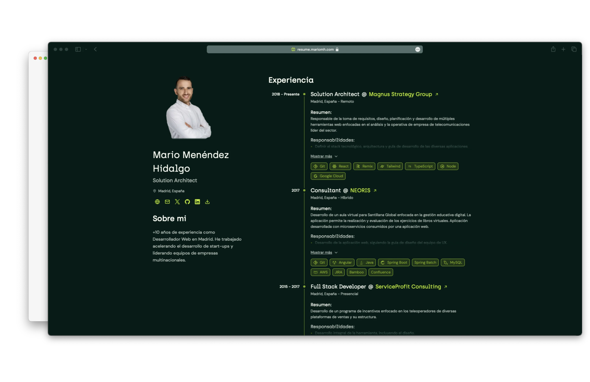

<h1 align="center">
  resume.mariomh.com
</h1>

<p align="center">
  A printable curriculum vitae and the <code>@mariomh8/resume</code> package.
</p>

<p align="center">
  <a href="https://resume.mariomh.com"></a>
  <a href="LICENSE"></a>
</p>



## Table of contents

- [Features](#features)
- [Tech stack](#tech-stack)
- [Lighthouse score](#lighthouse-score)
- [Requirements](#requirements)
- [Running locally](#running-locally)
- [The package](#the-package)
- [Deploying the site](#deploying-the-site)
- [Project structure](#project-structure)
- [Contributing](#contributing)
- [Security](#security)
- [License](#license)
- [Inspiration and credits](#inspiration-and-credits)

## Features

- 📱 Responsive design.
- 🎨 Light and dark theme.
- 🖨️ Printable layout (`Cmd + P` or `Ctrl + P`).
- 🌐 Spanish content with the CV data shared through a package.

## Tech stack

- **Runtime and package manager** - [Bun](https://bun.sh) 1.4.4
- **Frontend** - [Astro](https://astro.build)
- **Styling** - [Tailwind CSS](https://tailwindcss.com)
- **Language** - [TypeScript](https://www.typescriptlang.org)
- **Registry** - [GitHub Packages](https://github.com/features/packages)
- **Deployment** - [Cloudflare Pages](https://pages.cloudflare.com)

## Lighthouse score



## Requirements

- Bun 1.4.4
- Git
- A GitHub personal access token with `read:packages` to install `@mariomh8/resume` and the other private packages

## Running locally

Clone the repository and install the workspace:

```bash
git clone https://github.com/MarioMH8/resume.mariomh.com.git
cd resume.mariomh.com
bun install
```

Build the package and the site:

```bash
bun run build
```

Start the development server:

```bash
bun run dev
```

The main commands are:

| Task | Command |
| --- | --- |
| Build the package and the site | `bun run build` |
| Build only the package | `bun run build:packages` |
| Run the development server | `bun run dev` |
| Run the tests | `bun run test` |
| Type-check | `bun run typecheck` |
| Type-check the Astro sources | `bun run typecheck:astro` |
| Lint without writing changes | `bun run lint:ci` |
| Lint and fix | `bun run lint:fix` |
| Build and validate the package | `bun run check:packages` |

## The package

`@mariomh8/resume` publishes the CV data as JSON Resume (v1.2.1), the JSON Schema and the generated types. The package is private and lives in the `resume/` workspace.

```bash
bun run build:packages
bun run check:packages
```

Add the scope and your token to your user-level npm configuration:

```ini
//npm.pkg.github.com/:_authToken=${NPM_TOKEN}
@mariomh8:registry=https://npm.pkg.github.com/
```

Export `NPM_TOKEN` with a classic GitHub personal access token that has the `read:packages` permission. In CI the release workflow uses `GITHUB_TOKEN` with `packages: write`, and Renovate uses the `RENOVATE_PACKAGES_TOKEN` secret.

<!-- eslint-skip -->
```ts
import resume from '@mariomh8/resume';
import type { JSONResume } from '@mariomh8/resume';
import schema from '@mariomh8/resume/schema.json';
```

The default export is the resume object, the `JSONResume` type describes it and `schema.json` is the JSON Schema built from the Zod schemas in `resume/schema/`.

The CV data contains personal information. Read [CONTENT-LICENSE.md](CONTENT-LICENSE.md) before reusing it.

## Deploying the site

The site deploys automatically after the `Continuous integration` workflow succeeds on `main`. You can also run the [Deploy](https://github.com/MarioMH8/resume.mariomh.com/actions/workflows/deploy.yml) workflow manually with `workflow_dispatch`.

## Project structure

```text
src/               Astro site: assets, components, features, layouts and pages
resume/            @mariomh8/resume: data, Zod schemas, types and build
public/            Static files, the printable PDF and the portrait
docs/              Screenshots, the Lighthouse result and the agent guides
.github/           Workflows, issue templates and CODEOWNERS
```

## Contributing

Read [CONTRIBUTING.md](CONTRIBUTING.md) before opening an issue or a pull request. The project follows an issue-first workflow, Conventional Commits and GitFlow with `develop` as the integration branch and `main` for stable releases.

- [AGENTS.md](AGENTS.md): entry point for the repository guides.
- [docs/agents/](docs/agents/): architecture, conventions, development, releases, pull requests and branches.

## Security

Do not report vulnerabilities in a public issue. Follow [SECURITY.md](SECURITY.md) and use GitHub's private vulnerability reporting. The CV contains personal data, so report any unintended exposure through the same private channel.

## License

The source code is licensed under the [PolyForm Noncommercial License 1.0.0](LICENSE). You may read, use, modify and share it for noncommercial purposes, with the required notice.

The CV data, the portrait, the images and the documentation prose are **all rights reserved**. See [CONTENT-LICENSE.md](CONTENT-LICENSE.md) for the exact scope.

## Inspiration and credits

Some features and interactions are inspired by these resume sites. All the code is written from scratch.

- [Résumé minimalista by midudev](https://github.com/midudev/minimalist-portfolio-json)
- [Print-friendly portfolio CV by Ariel Cerda](https://github.com/Smilesharks/dev-portfolio)
